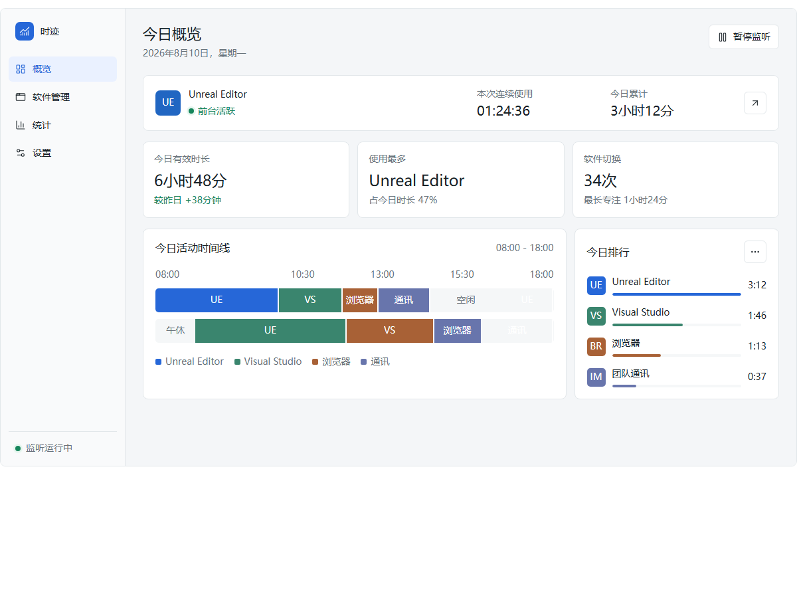
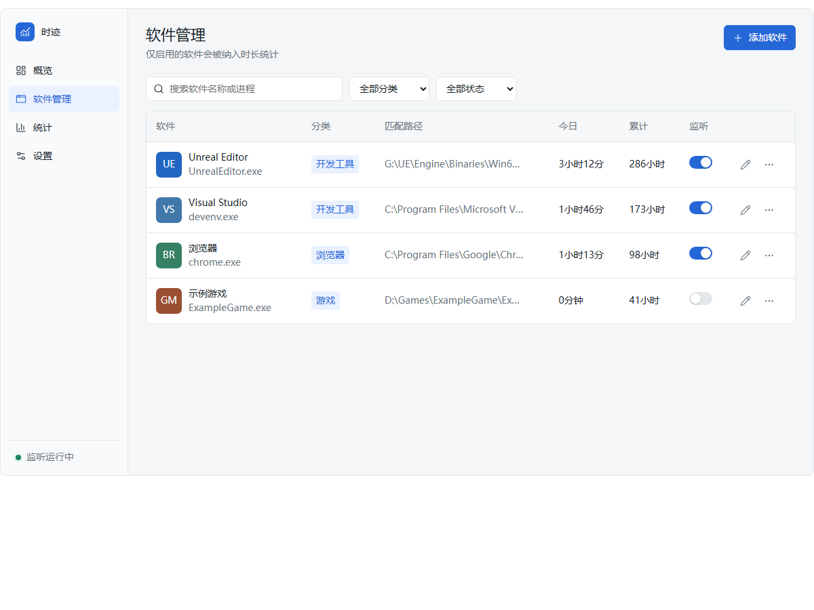
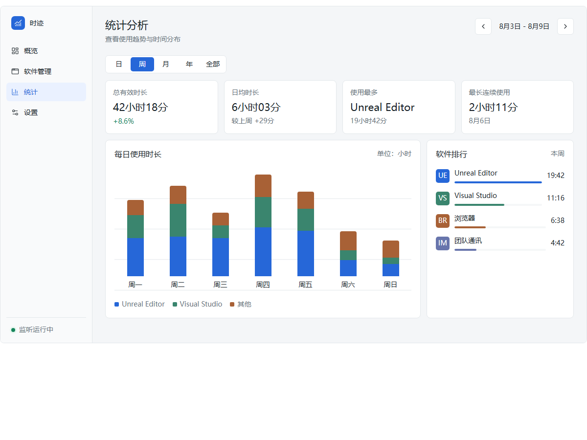
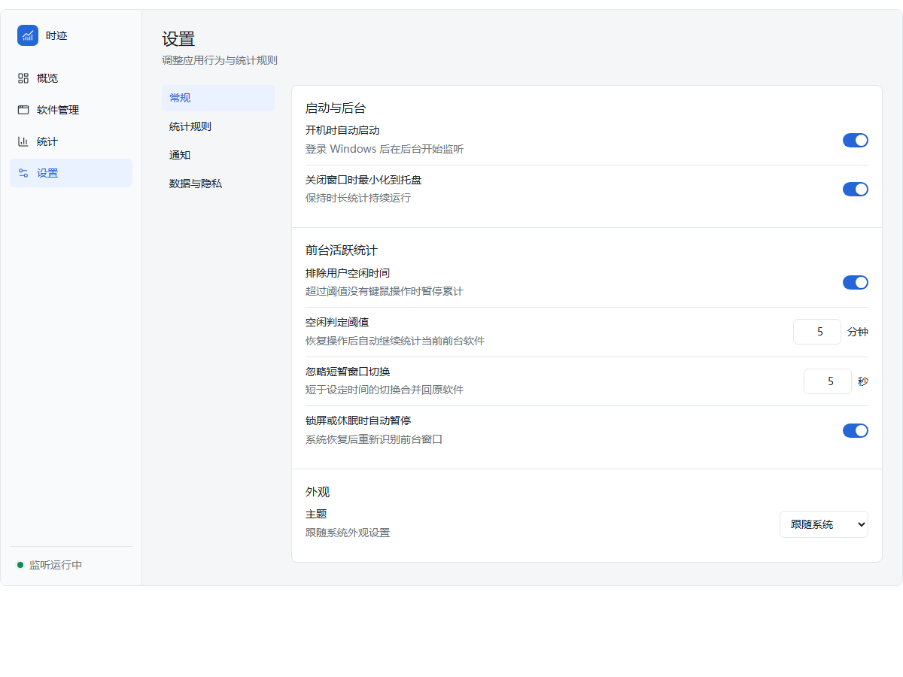

# 时迹 · app-usage-tracker

<div align="center">

[**🇨🇳 中文**](README.md) · **🇬🇧 English**

**Windows Software Usage Tracker**

Tracks only the effective time spent in configured apps that are in the foreground, while the machine is unlocked, awake and in use — so you know exactly where your time goes.

[](https://dotnet.microsoft.com/)
[](#requirements)
[](#license)

</div>

## ✨ Features

- **Foreground-aware tracking**: only configured and enabled apps are counted; no time accrues while the machine is locked, asleep, idle, paused, or in privacy mode.
- **Traceable raw sessions**: every start / end / reason is recorded; statistics can be rebuilt from sessions, with backfill, edit, merge and delete support.
- **Multi-dimensional statistics**: daily / weekly / monthly / yearly / all-time, including app rankings, trend bar charts and per-app details.
- **Today overview**: current app, continuous and cumulative durations, a zoomable activity timeline and today's ranking.
- **Tray resident**: runs in the background with a tray menu, auto-start, light / dark themes, and a global hotkey to show / hide.
- **Local-first**: data stays on your machine (JSON), with backup, restore, integrity check and CSV export.

## 🖼️ Screenshots

> The following are early UI mockups; the actual interface may differ from the shipped result.

| Overview | App management |
| --- | --- |
|  |  |

| Statistics | Settings |
| --- | --- |
|  |  |

## 🚀 Quick Start

### Requirements

- Windows 10 / 11
- [.NET 8 SDK](https://dotnet.microsoft.com/download/dotnet/8.0)
- Git Bash (for running `manager.sh` / `check-docs.sh`)

### Build & Run

```bash
sh manager.sh build   # Build the solution
sh manager.sh start   # Launch the app
```

### Common Commands

| Command | Description |
| --- | --- |
| `build` | Build the solution; extra `dotnet build` arguments are supported |
| `start` | Launch the WPF app; extra `dotnet run` arguments are supported |
| `test` | Run unit tests; extra `dotnet test` arguments are supported |
| `icon` | Regenerate the app icon (`Assets/app.ico` + `app.png`) |
| `package` | Package the dev zip and release folder/zip into `dist/`; extra publish arguments are supported |
| `pack` | Alias for `package` |
| `release` | Use `release <version>` to bump the version and package locally |
| `clean` | Clean build and runtime artifacts |
| `help` | Show help |

Run every command as `sh manager.sh <command>`.

Windows users can skip Git Bash and double-click the `.bat` scripts directly. Shared logic lives in `scripts/*.ps1`; apart from `package.bat`, which uses Windows PowerShell, the entrypoints select PowerShell 7 or Windows PowerShell automatically:

| Script | Description |
| --- | --- |
| `build.bat` | Build the solution (args `Debug`/`Release`; extra `dotnet build` args supported) |
| `test.bat` | Run every test project (args `Debug`/`Release`; extra `dotnet test` args supported) |
| `dev.bat` | Rebuild Debug and start for development, asking any running instance to close normally first |
| `run.bat` | Start the built app, building the selected configuration first if needed |
| `stop.bat` | Request a normal close and wait; never force-kills. Exit from the tray if the window only minimizes |
| `status.bat` | Show app processes and script-managed run state |
| `package.bat` | Package the dev zip and release folder/zip into `dist/` (asks first if the app is running) |
| `publish.bat` | Legacy alias for `package.bat`; old `self`/`fx` arguments are ignored |
| `clean.bat` | Clean managed build artifacts; refuses while the app is running and never deletes user data |
| `ci.bat` | One-shot pipeline: clean → build Release → test Release → package |

BAT scripts pause after completion by default; `package.bat` does not pause so CI and automation can call it directly. Set `APP_USAGE_TRACKER_NO_PAUSE=1` to skip the pause in the other scripts.

## 📦 Packaging

```bash
sh manager.sh package
```

The single source of the version is `<Version>` in `src/AppUsageTracker/AppUsageTracker.csproj`. Outputs:

| Path | Content |
| --- | --- |
| `dist/dev/AppUsageTracker_<version>_x64-unpack-debug.zip` | Debug build + build log + `build-info.txt`, with a matching top-level folder inside the zip |
| `dist/release/unpack/` | Portable Release win-x64 self-contained single-file folder (includes README and offline screenshot assets) |
| `dist/release/AppUsageTracker_<version>_x64-unpack.zip` | Packed from `unpack`; the exe sits directly at the zip root |

Packaging first verifies assembly versions and zip contents in a unique staging directory, then transactionally replaces `dist/dev` / `dist/release`; failures roll back and keep the staging tree. The legacy `dist/AppUsageTracker.exe` is removed after the new layout is published successfully. If AppUsageTracker is running, the script lists the processes and asks; only `Y` closes them (normal close first, forced after 12 seconds if needed) and continues. Any other answer cancels.

## 🧱 Tech Stack

| Area | Choice |
| --- | --- |
| Language / runtime | C# / .NET 8 (`net8.0-windows`) |
| Desktop UI | WPF |
| Architecture | MVVM (CommunityToolkit.Mvvm 8.3.2) |
| Foreground monitoring | Win32 P/Invoke (WinEventHook / foreground window) |
| Persistence | System.Text.Json (local JSON, atomic writes) |
| System tray | WinForms NotifyIcon |
| Testing | xUnit |

## 📁 Project Structure

```text
app-usage-tracker/
├── src/AppUsageTracker/          WPF main project (Models/Services/ViewModels/Views/Themes/Controls)
├── tests/AppUsageTracker.Tests/  xUnit unit tests
├── docs/                         Usage, tech, design and UI assets
├── tools/                        Icon generation and UI capture scripts
├── scripts/                      PowerShell build, run and release logic behind BAT entries
├── .claude/                      Shared documentation hook and opt-in skills
├── manager.sh                    Unified build, run, test and release entrypoint
├── check-docs.sh                 Mechanical documentation checks
├── AGENTS.md                     Long-term AI working rules
├── ARCHITECTURE.md               Code architecture map
├── ROADMAP.md                    Overall plan and milestones
├── CHANGELOG.md                  User-facing release history
└── HANDOFF.md                    Active cross-session status
```

## 📚 Documentation

> Documentation is currently in Chinese.

- [Documentation index](docs/00-目录.md)
- [Usage guide](docs/02-使用说明.md)
- [Tech stack](docs/01-技术栈说明.md)
- [Product design](docs/design/software-usage-duration-design.md)
- [Architecture map](ARCHITECTURE.md)
- [Roadmap](ROADMAP.md)
- [Changelog](CHANGELOG.md)

## ⚖️ License

No open-source license has been specified yet; please confirm before using or distributing.
