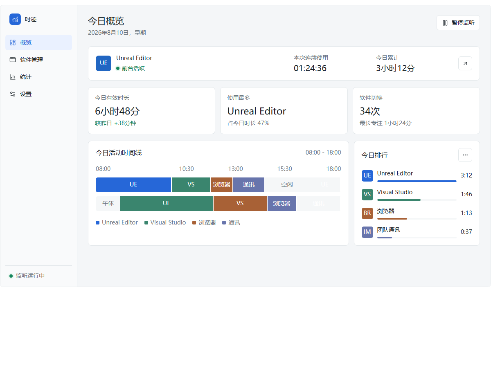
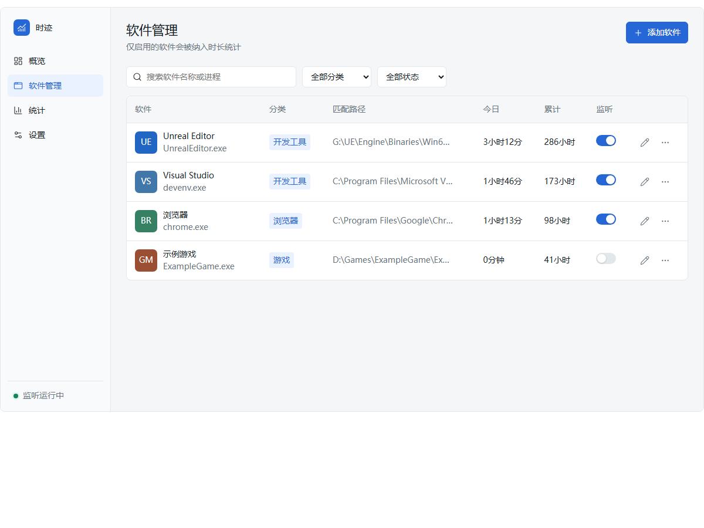
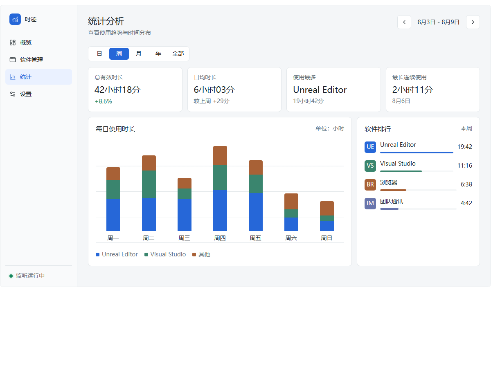
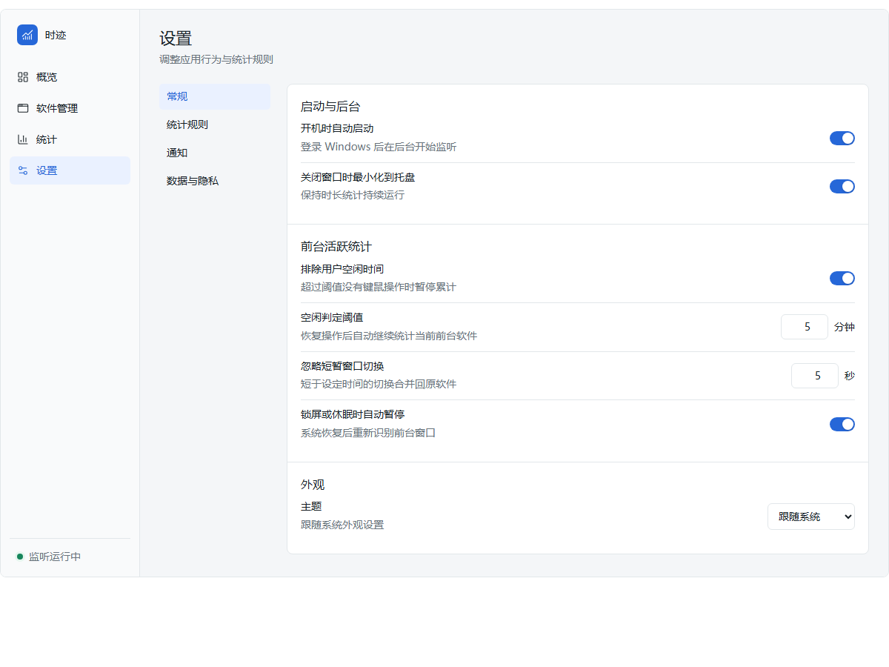

# 时迹 · app-usage-tracker

<div align="center">

**🇨🇳 中文** · [**🇬🇧 English**](README-EN.md)

**Windows 软件使用时长统计工具**

默认只记录「已配置软件 + 前台激活 + 未锁屏/休眠 + 未空闲」的有效使用时长，帮你搞清楚时间都花在了哪里。

[](https://dotnet.microsoft.com/)
[](#环境要求)
[](#许可)

</div>

## ✨ 特性

- **前台有效统计**：只统计已配置并启用的软件；锁屏、休眠、空闲、暂停、隐私模式期间不累计时长。
- **原始会话可追溯**：每次开始 / 结束 / 原因都有记录，统计结果可从会话重建，支持补录、修改、合并、删除。
- **多维度统计**：日 / 周 / 月 / 年 / 全部时间，含软件排行、趋势柱状图和软件详情。
- **今日概览**：当前软件、连续与累计时长、可缩放的活动时间线和今日排行。
- **托盘常驻**：后台运行、托盘菜单、开机自启、浅 / 深主题、全局快捷键呼出 / 隐藏。
- **本地优先**：数据仅存本机（JSON），支持备份、恢复、完整性检查与 CSV 导出。

## 🖼️ 界面预览

> 以下为早期界面设计稿，实际界面以运行效果为准。

| 概览 | 软件管理 |
| --- | --- |
|  |  |

| 统计分析 | 设置 |
| --- | --- |
|  |  |

## 🚀 快速开始

### 环境要求

- Windows 10 / 11
- [.NET 8 SDK](https://dotnet.microsoft.com/download/dotnet/8.0)
- Git Bash（用于运行 `manager.sh` / `check-docs.sh`）

### 构建与运行

```bash
sh manager.sh build   # 构建解决方案
sh manager.sh start   # 启动应用
```

## 🛠️ manager.sh 命令一览

| 命令 | 说明 |
| --- | --- |
| `build` | 构建解决方案，可追加 `dotnet build` 参数 |
| `start` | 启动 WPF 应用，可追加 `dotnet run` 参数 |
| `test` | 运行单元测试，可追加 `dotnet test` 参数 |
| `icon` | 重新生成应用图标（`Assets/app.ico` + `app.png`） |
| `package` | 打包 dev 调试 zip 与 release 免安装目录/zip 到 `dist/`，可追加发布参数 |
| `pack` | `package` 的兼容别名 |
| `release` | 按 `release <version>` 升级版本号并打包（本地，不含 git/CHANGELOG） |
| `clean` | 清理构建与运行产物 |
| `help` | 显示帮助 |

所有命令统一以 `sh manager.sh <命令>` 形式运行。

Windows 用户也可不装 Git Bash，直接双击运行 `.bat` 脚本；公共逻辑位于 `scripts/*.ps1`。除 `package.bat` 固定使用 Windows PowerShell 外，其余入口自动选用 PowerShell 7 或 Windows PowerShell：

| 脚本 | 说明 |
| --- | --- |
| `build.bat` | 构建解决方案（参数 `Debug`/`Release`，可追加 `dotnet build` 参数） |
| `test.bat` | 运行全部测试项目（参数 `Debug`/`Release`，可追加 `dotnet test` 参数） |
| `dev.bat` | 开发入口：正常关闭已运行实例后重新构建 Debug 并启动，可追加应用参数 |
| `run.bat` | 启动已构建应用；缺少对应配置时先构建（参数 `Debug`/`Release`） |
| `stop.bat` | 请求正常关闭并等待；不会强制结束进程，托盘常驻时需从托盘菜单退出 |
| `status.bat` | 查看应用进程与脚本启动记录 |
| `package.bat` | 打包 dev 调试 zip 与 release 免安装目录/zip 到 `dist/`（检测到运行实例先询问） |
| `publish.bat` | 兼容旧入口，等价于 `package.bat`；旧的 `self`/`fx` 参数忽略 |
| `clean.bat` | 清理受管的构建产物；应用运行时拒绝执行，不删除用户数据 |
| `ci.bat` | 一键流水线：clean → build Release → test Release → package |

BAT 脚本默认在结束后暂停；`package.bat` 为便于 CI / 自动化不暂停。自动化调用其它脚本可设置 `APP_USAGE_TRACKER_NO_PAUSE=1` 跳过暂停。

## 📦 打包

```bash
sh manager.sh package
```

版本号单一来源是 `src/AppUsageTracker/AppUsageTracker.csproj` 的 `<Version>`。产物：

| 路径 | 内容 |
| --- | --- |
| `dist/dev/AppUsageTracker_<版本>_x64-unpack-debug.zip` | Debug 构建 + 构建日志 + `build-info.txt`，zip 内有同名顶层目录 |
| `dist/release/unpack/` | Release win-x64 自包含单文件免安装目录（含 README 与离线截图资源） |
| `dist/release/AppUsageTracker_<版本>_x64-unpack.zip` | 从 `unpack` 内部打包，解压后 exe 直接在 zip 根下 |

打包先在唯一暂存目录校验程序集版本与 zip 内容，成功后事务更新 `dist/dev` / `dist/release`，失败回滚并保留暂存现场；旧布局的 `dist/AppUsageTracker.exe` 会在新布局首次打包成功后清理。若检测到运行中的 AppUsageTracker，会列出进程并询问，只有输入 `Y` 才关闭（先尝试正常关闭，12 秒后仍未退出则强制结束）并继续，其它输入取消。

## 🧱 技术栈

| 领域 | 选型 |
| --- | --- |
| 语言 / 运行时 | C# / .NET 8（`net8.0-windows`） |
| 桌面 UI | WPF |
| 架构模式 | MVVM（CommunityToolkit.Mvvm 8.3.2） |
| 前台监听 | Win32 P/Invoke（WinEventHook / 前台窗口） |
| 持久化 | System.Text.Json（本地 JSON，原子写入） |
| 系统托盘 | WinForms NotifyIcon |
| 测试 | xUnit |

## 📁 项目结构

```text
app-usage-tracker/
├── src/AppUsageTracker/          WPF 主项目（Models/Services/ViewModels/Views/Themes/Controls）
├── tests/AppUsageTracker.Tests/  xUnit 单元测试
├── docs/                         使用、技术、设计与界面资源
├── tools/                        图标生成与 UI 截图脚本
├── scripts/                      BAT 对应的 PowerShell 构建、运行与发布逻辑
├── .claude/                      共享文档检查 hook 与按需技能
├── manager.sh                    构建、运行、测试与发布统一入口
├── check-docs.sh                 文档体系机械检查
├── AGENTS.md                     AI 长期工作规则
├── ARCHITECTURE.md               代码链路图谱
├── ROADMAP.md                    总体计划与里程碑
├── CHANGELOG.md                  面向使用者的版本记录
└── HANDOFF.md                    进行中的跨会话状态
```

## 📚 文档

- [文档目录](docs/00-目录.md)
- [使用说明](docs/02-使用说明.md)
- [技术栈说明](docs/01-技术栈说明.md)
- [产品设计文档](docs/design/software-usage-duration-design.md)
- [架构图谱](ARCHITECTURE.md)
- [开发路线图](ROADMAP.md)
- [版本变更记录](CHANGELOG.md)

## ⚖️ 许可

本项目暂未指定开源许可，使用与分发前请先确认。
